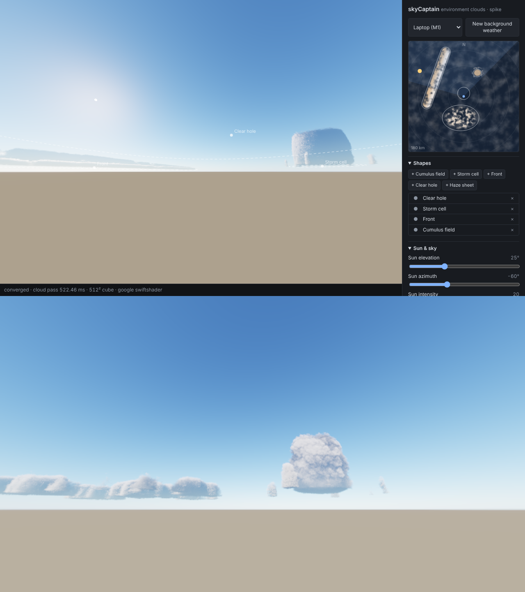
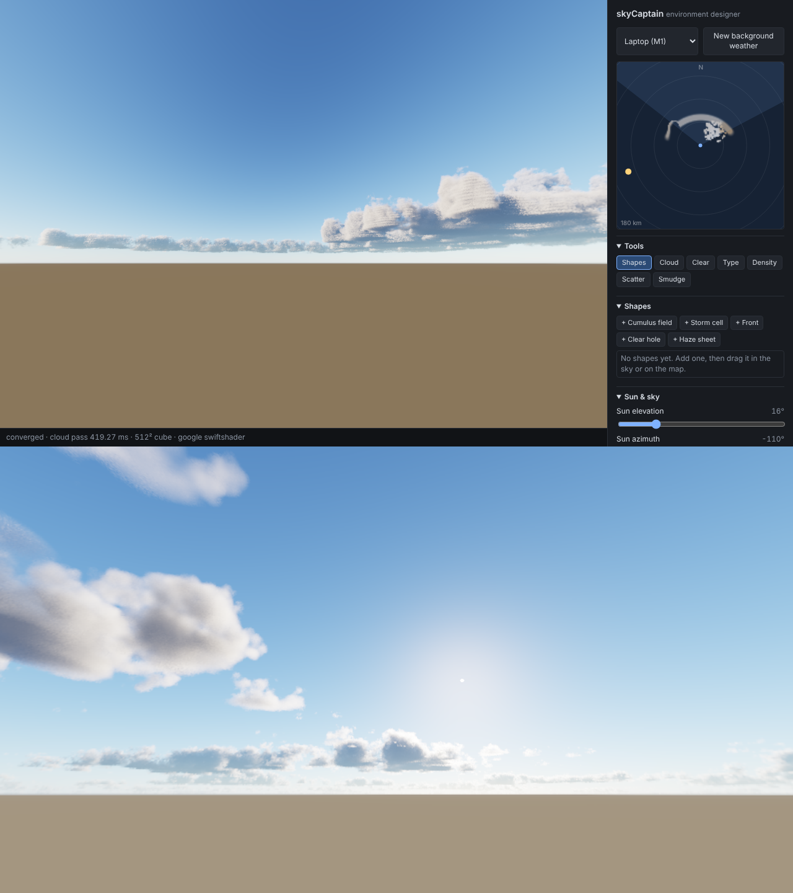
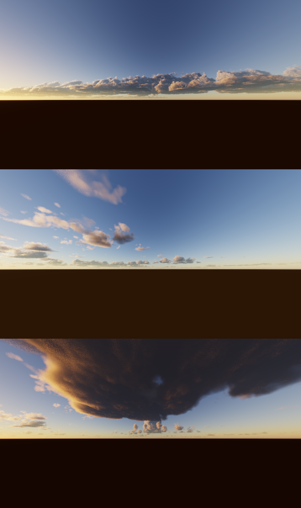
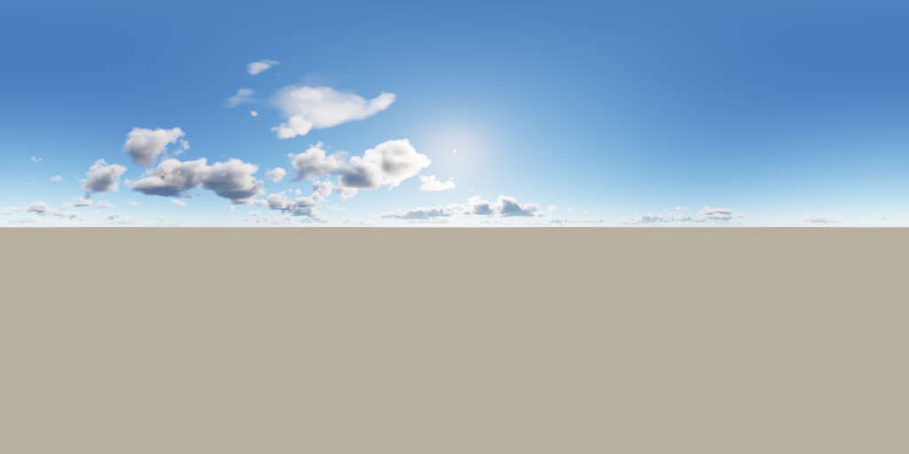
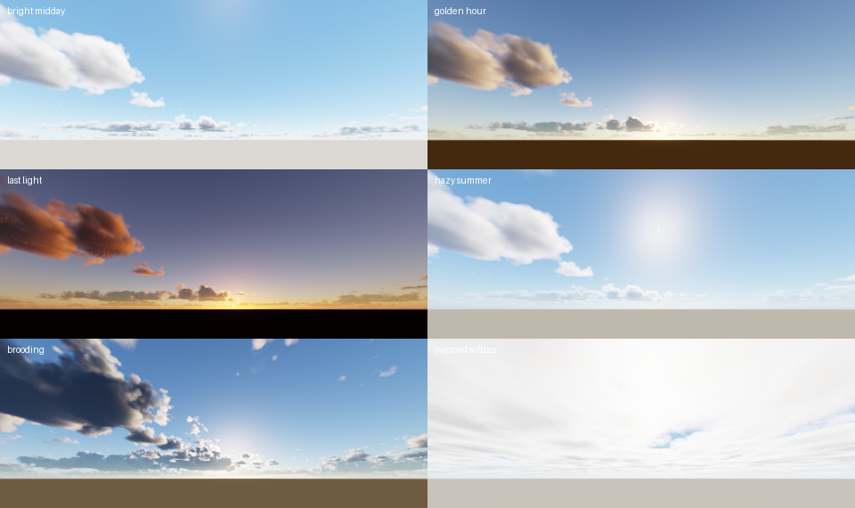

# skyCaptain

Directable environments for the Wild Construct suite: paint and shape a sky in
the browser with WebGPU, export scene-linear HDRIs and a portable recipe.

*Spike look test, rendered with software WebGPU: midday cumulus, overhead view,
low-sun towering cloud.*

## How it renders

The eye is fixed, so clouds don't depend on where the camera is looking. They are
raymarched once into the environment cube, and the viewport only samples it.

| Pass | Runs when | Notes |
| --- | --- | --- |
| Noise bake | startup | 128³ Perlin-Worley + Worley shape, 32³ Worley detail, rgba8 |
| Weather map | weather edits | 512², coverage / type / density. Paint and shape layers land here |
| Atmosphere | sun or haze edits | Hillaire 2020 transmittance + multi-scattering LUTs, 256² sky cube |
| Clouds | any cloud edit, until converged | Compute pass; 1/16 of cube texels per frame in Bayer order. The first frames fill at quarter, then half resolution, so edits show immediately. Later passes add jittered samples |
| View | every frame | Samples sky × transmittance + cloud scatter + sun disc. Preview-only tone map |

Cloud lighting follows Nubis 2015 / Hillaire 2016:
- density from the weather map × a vertical profile by cloud type × Perlin-Worley with detail erosion
- Beer-Lambert transmittance, integrated with Hillaire's energy-conserving step integral
- dual-lobe Henyey-Greenstein phase
- Wrenninge multiple-scattering octaves
- cone light march toward the sun
- sky ambient, occluded by the cloud above
- distance fade into the atmosphere

Quality tiers: Laptop (M1) 512² × 64 steps, Desktop 768² × 96, Ultra 1024² × 128.

## Shapes

Shape layers are weather generators placed on the map. They composite in order
over the procedural background weather (its strength is the **Background
weather** slider) and write coverage, cloud type and density into the weather
map:

- **Cumulus field:** separate fair-weather cumulus islands.
- **Storm cell:** a towering, dome-shaped core with a broken ring of outflow cumulus.
- **Front:** a band of cloud, with towers on the leading edge and stratiform cloud behind.
- **Clear hole:** removes coverage.
- **Haze sheet:** thin, low-density stratus.

Each cloud type has its own height. Stratus are about 0.35 km, cumulus use
**Cumulus height**, and towers rise to **Max tower height**. Coverage shrinks
with height, so tops round off.

Editing:
- **In the sky:** drag a shape. Drag empty sky to look around. Shapes are added
  where you are looking.
- **On the minimap:** drag to move, use the square handle to size and rotate, and
  the round handle to set width.
- **Shortcuts:** Ctrl/Cmd+Z to undo, Shift+Ctrl/Cmd+Z to redo, Delete to remove a
  shape.

`node tools/smoke-shapes.mjs` checks these interactions and the GPU weather map
against the dev server.

## Painting

Paint layers are applied after the shapes. Brushes (keys 1 to 6; V returns to Shapes):

- **Cloud:** adds coverage up to **Max coverage**. Below 1, the noise still carves
  separate clouds; 1 paints toward an overcast deck. Can also set the cloud type.
- **Clear:** removes coverage.
- **Type:** pushes clouds toward stratus or towers.
- **Density:** thickens, or thins.
- **Scatter:** sprays small separate clouds.
- **Smudge:** drags the whole weather (background, shapes and paint) along the
  stroke. It writes a displacement field rather than moving pixels, so it stays
  non-destructive.

Paint in the sky or top-down on the minimap. With a brush active, right-drag or
Space-drag looks around. `[` and `]` change brush size. Shapes and paint share one
undo history; paint undo stores only the 64×64 tiles a stroke touched.
`node tools/smoke-paint.mjs` checks each brush against the GPU weather map.

## Sky graphs (Prompt Spaghetti)

A `.psg` graph rolls whole skies: shapes, cloud controls, sun and a caption. Load
`examples/weather-regimes.psg` with **Example graph**, press **R** to reroll, and hold
choices, shape slots or the sun so they survive rerolls. Graph-made shapes sit below
your hand-made ones; rerolls never touch hand-made shapes or paint. Details in
[docs/psg-weather.md](docs/psg-weather.md). `node tools/smoke-psg.mjs` checks load,
reroll, holds and undo.

## Export and sky files

**Export HDRI** renders the environment fresh at export quality and downloads a
scene-linear lat-long image, with north at the centre and east to the right:
- **Formats:** OpenEXR or Radiance `.hdr`.
- **Sizes:** 1K, 2K or 4K.
- **Quality:** 2, 8 or 16 samples per texel.
- **How it renders:** clouds go into a dedicated cube (face = width ÷ 4, Ultra steps,
  full convergence) and are composited with the same shaders as the view, with a
  supersampled sun disc.
- **EXR precision:** written as half float when everything fits, and as 32-bit float
  when the sun exceeds the half range (it usually does), so the sun's energy is never
  clamped.

`tools/smoke-export.mjs` drives the button and checks every pixel. `tools/check-hdri.py`
re-reads the files with the OpenEXR and OpenCV readers.

**Save sky / Open sky** store the whole sky in one `.sky.json`:
- settings and shape layers
- paint, as sparse tiles (int16 paint, float32 smudge warp)
- the sky graph, with its text, seed, holds and resolved values

Opening restores the saved roll without re-evaluating, so a later edit to the graph
can't change a saved sky. `tools/smoke-document.mjs` round-trips a sky and compares the
GPU weather map.

## Vibes

One click sets the sun, atmosphere, light and cloud character. The vibes are Bright
midday, Golden hour, Last light, Hazy summer, Brooding and Overcast softbox. They never
touch shapes or paint, so you can try a vibe over any composed sky (`src/vibes.ts`).

## Roadmap

1. **Look spike.** Done.
2. **Shapes.** Done: five generators, sky and minimap editing, undo.
3. **Speed.** Measure on M1 and 4090. Tune steps, empty-space skipping and tiers.
   Target: a visible draft in one frame and convergence in about 1 s on M1 Laptop tier.
4. **Painting.** Done: six brushes, sky and minimap painting, shared undo.
5. **PSG weather.** Done: a vendored browser build of Prompt Spaghetti's evaluator,
   an example graph, reroll and holds.
6. **Look polish.** Cumulonimbus anvils, ground shadows from clouds, horizon and
   ground model, edge albedo instead of powder.
7. **Export and documents.** Done: EXR/HDR export and `.sky.json` save/open.
8. **Vibes.** Done: six look presets. Still to do: a WCX wrapper for the suite.
9. **Ground and skylight.** The ground is lit only by the sun today, so low-sun skies have a
   near-black ground. Add sky irradiance and cloud shadows on the ground.
