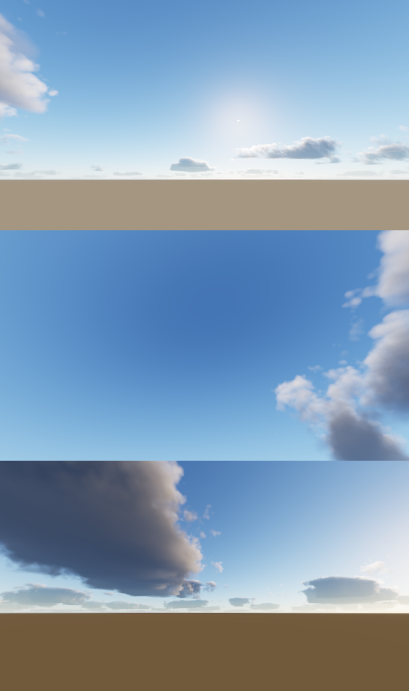

# skyCaptain

Directable environments for the Wild Construct suite: paint and shape a sky in
the browser with WebGPU, export scene-linear HDRIs and a portable recipe.

*Spike look test, rendered with software WebGPU: midday cumulus, overhead view,
low-sun towering cloud.*

## How it renders

The eye is fixed, so clouds don't depend on where the camera is looking. They are
raymarched once into the environment cube, and the viewport only samples it.

| Pass | Runs when | Notes |
| --- | --- | --- |
| Noise bake | startup | 128³ Perlin-Worley + Worley shape, 32³ Worley detail, rgba8 |
| Weather map | weather edits | 512², coverage / type / density. Paint and shape layers land here |
| Atmosphere | sun or haze edits | Hillaire 2020 transmittance + multi-scattering LUTs, 256² sky cube |
| Clouds | any cloud edit, until converged | Compute pass; 1/16 of cube texels per frame in Bayer order. The first frames fill at quarter, then half resolution, so edits show immediately. Later passes add jittered samples |
| View | every frame | Samples sky × transmittance + cloud scatter + sun disc. Preview-only tone map |

Cloud lighting follows Nubis 2015 / Hillaire 2016:
- density from the weather map × a vertical profile by cloud type × Perlin-Worley with detail erosion
- Beer-Lambert transmittance, integrated with Hillaire's energy-conserving step integral
- dual-lobe Henyey-Greenstein phase
- Wrenninge multiple-scattering octaves
- cone light march toward the sun
- sky ambient, occluded by the cloud above
- distance fade into the atmosphere

Quality tiers: Laptop (M1) 512² × 64 steps, Desktop 768² × 96, Ultra 1024² × 128.

## Roadmap

1. **Look spike.** Done: the image above. Needs a look check on real hardware.
2. **Speed.** Measure on M1 and 4090. Tune steps, empty-space skipping and tiers.
   Target: a visible draft in one frame and convergence in about 1 s on M1 Laptop tier.
3. **Lighting polish.** Ground shadows from clouds, horizon and ground model,
   edge albedo instead of powder.
4. **Painting.** Layer stack resolved into the weather map: coverage, type,
   density, erase, wind smudge and scatter brushes, painted directly in the sky.
5. **Shapes and randomize.** Vector shapes as weather generators (cumulus field,
   storm cell, front line, clear hole, haze sheet), each with a seed. Reroll
   unlocked layers. PSD layer import is a possible authoring path.
6. **Vibes and export.** Look presets (sun + atmosphere + clouds), lat-long
   `.hdr`/`.exr` export from the cube, and a recipe/WCX document.
